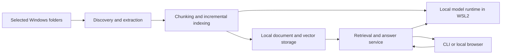

# Local document search design

The application will help its owner find information in selected local documents and answer questions with citations. Extraction, indexing, retrieval, reranking, and generation run on the owner's computer. The deployment boundary is agreed: native Windows for the document service, Docker on WSL2 for the model runtime. The component and storage choices below are the initial implementation proposal.

## Scope

The target inputs are PDF, Word (`.docx`), Markdown, and text. Start with Markdown and UTF-8 text. Add text-based PDF and `.docx` after the indexing and citation behavior is reliable. Scanned PDF extraction and legacy `.doc` conversion need separate evaluation before being added.

Sources are explicitly selected folders. Indexing the whole computer is not the default. Source files are read-only inputs; generated indexes, extraction caches, and logs live in a separate configurable application data directory.

The initial product includes document search and grounded answers. A CLI proves the workflow first; a local browser interface follows. MCP can be added as another client of the same retrieval service.

## Service boundary

`local-rag` owns source configuration, document extraction, citations, index persistence, search, answer assembly, and its user interface. `local-model-runtime` owns model files, backend configuration, GPU allocation, service startup, readiness, and model loading and unloading. The repositories share an HTTP contract, not Python imports or a database. See the [runtime contract](../model-runtime-contract.md).

The RAG service can remain running while model services are stopped. Document status remains available; operations requiring inference report that the runtime is unavailable.

## Document ingestion

Give each configured source a stable ID. Identify a document by its source and normalized path, retaining the original Windows path for opening citations. Canonical path checks enforce the selected source boundaries. Define an explicit policy for symlinks, junctions, and unavailable drives; do not follow paths outside configured roots.

Extract structured text before chunking. Markdown and text retain line offsets; PDF retains page numbers and text spans; Word retains heading paths and paragraph positions. Word page numbers are not stable without a rendering step, so cite sections and paragraphs. A citation records the document revision associated with the indexed text.

Use bounded file sizes and process documents incrementally. Do not load the entire corpus into memory. Extraction failures remain visible in document status. Chunking preserves section boundaries and retains original text for display; model-specific input formatting is applied separately.

Content hashes and extraction/chunking profiles determine whether a document needs indexing. Build a replacement document revision before activating it. Readers see either the previous complete revision or the new complete revision. If metadata and vectors use separate stores, an active revision marker governs visibility and interrupted jobs can reconcile unfinished writes.

An empty document removes its previous searchable content. A read failure preserves the previous revision and reports a failure. A missing or unreadable source root does not imply that all its documents were deleted. Confirm document deletions only after successful source enumeration.

## Storage and model identity

Use SQLite for document metadata, jobs, active revisions, and configuration stamps. Milestone 1 also stores vectors in SQLite and uses exact CPU scans through the storage component. This lets document metadata and vectors share atomic transactions with no native extension dependency. See [the pilot storage decision](../decisions/0001-sqlite-pilot-storage.md). Revisit accelerated vector retrieval when corpus size and real embedding dimensions justify it.

An embedding profile identifies the model and revision, vector dimension, normalization, tokenizer revision, input limits, and query/document formatting. Persist its fingerprint with every index generation. An incompatible profile cannot query an older index; rebuilding creates a new generation and activates it only after validation. Reranker and generation model changes do not by themselves invalidate stored embeddings.

## Retrieval and answers

Run lexical search over the corpus independently of vector retrieval, merge their candidates, then optionally rerank the result. This allows exact terms to recover documents absent from the vector candidate pool. Measure candidate recall and reranking improvements on representative document questions.

Retrieve complete passages with source locators. Give the LLM numbered evidence passages and request citations to those identifiers. Validate that returned citation identifiers exist in the supplied evidence; display original excerpts beside the answer. Valid identifiers establish traceability, not whether the model's claim is supported, so evaluation must also check answer grounding. When evidence is insufficient, the assistant says so.

Treat document text as source material, not instructions to execute tools or contact external services. A cited file that has changed since indexing is marked stale and queued for refresh.

## Local operation

Inference endpoints use explicit loopback addresses. There is no cloud fallback. Normal indexing and querying do not download models or tokenizers. Installation and deliberate model downloads are separate operations with visible network requirements. GPU execution requires separate explicit user approval; the first implementation contains only CPU test vectors and no inference endpoint client.

Logs contain job identifiers, timings, status, and errors; document text and full prompts are excluded by default. Dependencies, models, tokenizer files, and extraction tools are provisioned before the offline acceptance test. The UI is served locally and does not depend on remote scripts, fonts, analytics, or hosted assets.

## Testing and delivery

Use synthetic documents first. Tests cover path boundaries, repeated passages, Unicode filenames, empty files, edits, deletion, read failures, unavailable roots, interrupted indexing, model-profile changes, and citation locations. Integration tests cover runtime response validation, cold starts, unavailable services, and offline operation.

The reference project contributes regression cases, not an inherited architecture. Known cases include stale chunks after a document becomes empty, read failures treated as deletions, global embedding-version stamps affecting only the first source, and retrieval evaluation passing with an empty question set.

Follow the [implementation milestones](../implementation-plan.md). Model choices, a vector backend for larger corpora, the UI framework, and OCR tooling remain open until their corresponding milestone supplies evidence.
